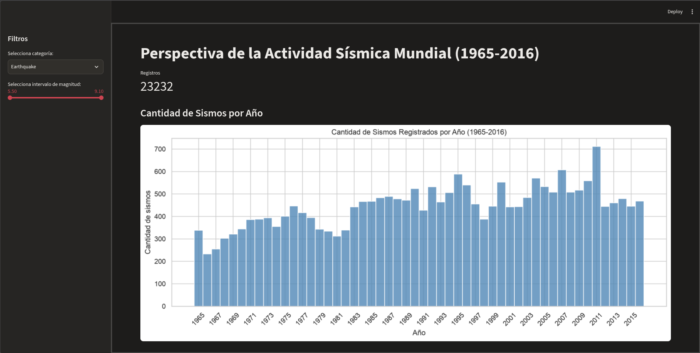

# 🌎 Análisis Exploratorio de Eventos Sísmicos Mundiales (1965–2016)

[](https://global-seismic-analysis-dashboard.streamlit.app/)

## 📌 Descripción del proyecto

Este proyecto consiste en el desarrollo de un dashboard interactivo para realizar un análisis exploratorio de los eventos sísmicos registrados alrededor del mundo entre los años 1965 y 2016. Su propósito es identificar patrones históricos, comprender el comportamiento de la actividad sísmica y facilitar la interpretación de los datos mediante visualizaciones interactivas y estadísticas descriptivas.

Para desarrollar el análisis se utilizó el conjunto de datos **Significant Earthquakes, 1965–2016**, disponible en [Kaggle](https://www.kaggle.com/datasets/usgs/earthquake-database). Este dataset contiene registros históricos de eventos sísmicos e incluye información como fecha, ubicación geográfica, magnitud, profundidad y tipo de evento.

La elección de este conjunto de datos se debe a su cobertura temporal y geográfica, así como a la variedad de atributos que permite estudiar. Estos elementos facilitan la identificación de tendencias, la comparación entre diferentes tipos de eventos y el análisis de su distribución a lo largo del tiempo. Los resultados se presentan mediante un dashboard desarrollado con Python y Streamlit, orientado tanto a usuarios técnicos como a personas sin conocimientos especializados en análisis de datos.

## 🖥️ Dashboard

El proyecto está publicado en Streamlit Community Cloud y puede consultarse directamente desde el siguiente enlace:

**[Acceder al dashboard interactivo](https://global-seismic-analysis-dashboard.streamlit.app/)**

### Captura de pantalla

A continuación, se presenta una captura del dashboard en funcionamiento:



> Para visualizar la captura, guarda una imagen del dashboard en funcionamiento dentro de la carpeta `docs/` con el nombre `dashboard.png`.

## 📊 Principales hallazgos del análisis exploratorio (EDA)

A partir de la exploración de los registros sísmicos se destacan los siguientes aspectos:

1. **Distribución temporal:** se identificaron variaciones en la cantidad de eventos sísmicos registrados a lo largo del periodo 1965–2016, permitiendo reconocer los años con mayor concentración de registros.

2. **Magnitud de los eventos:** los registros presentan diferentes niveles de magnitud, lo que permite distinguir entre eventos de menor y mayor intensidad.

3. **Profundidad sísmica:** se observaron diferencias en la profundidad a la que ocurren los eventos, una característica importante para comprender su comportamiento.

4. **Tipos de eventos:** se identificaron distintas categorías de fenómenos sísmicos, siendo posible comparar su frecuencia de aparición y sus características.

5. **Distribución geográfica:** los registros muestran que la actividad sísmica se presenta en diferentes regiones del mundo, permitiendo explorar su distribución espacial.

> Nota: Estos hallazgos constituyen una síntesis general del análisis. Se recomienda ajustarlos de acuerdo con los resultados y las visualizaciones obtenidas durante la ejecución del proyecto.

## ⚙️ Tecnologías utilizadas

- **Python:** lenguaje de programación principal.
- **Pandas:** procesamiento y manipulación de datos.
- **NumPy:** operaciones numéricas.
- **Matplotlib / Seaborn:** generación de visualizaciones (si aplica).
- **Plotly:** visualizaciones interactivas (si aplica).
- **Streamlit:** desarrollo y publicación del dashboard.

## 🚀 Instalación y ejecución local

Sigue estos pasos para descargar, configurar y ejecutar el proyecto en tu equipo.

### 1. Clonar el repositorio

```bash
git clone [URL_DEL_REPOSITORIO]
```

Ingresar al directorio:

```bash
cd [NOMBRE_DEL_REPOSITORIO]
```

### 2. Crear un entorno virtual

Se recomienda utilizar un entorno virtual para mantener aisladas las dependencias del proyecto.

```bash
python -m venv venv
```

Activar el entorno virtual:

**Windows (PowerShell):**

```powershell
.\venv\Scripts\Activate.ps1
```

**Linux / macOS:**

```bash
source venv/bin/activate
```

### 3. Instalar las dependencias

Instalar los paquetes necesarios mediante el archivo `requirements.txt`:

```bash
pip install -r requirements.txt
```

### 4. Configurar los datos

Verificar que el conjunto de datos esté ubicado en la ruta esperada por la aplicación.

```text
[NOMBRE_DEL_REPOSITORIO]/
├── app.py
├── requirements.txt
├── README.md
├── data/
│   └── [database.csv]
└── docs/
    └── dashboard.png
```

> Si el dataset no está incluido en el repositorio, descárgalo desde la fuente indicada en la descripción del proyecto y ubícalo en la carpeta correspondiente.

### 5. Ejecutar el dashboard

Desde la raíz del proyecto, ejecutar:

```bash
streamlit run app.py
```

### 6. Acceder a la aplicación

Una vez iniciada la ejecución, Streamlit mostrará la dirección local del dashboard.

Abrir en el navegador:

```text
http://localhost:8501
```

Para detener la aplicación, presionar `Ctrl + C` en la terminal.

## 📁 Estructura del proyecto

```text
.
├── app.py
├── requirements.txt
├── README.md
├── data/
│   └── [ARCHIVO_DATASET.csv]
└── docs/
    └── dashboard.png
```

La estructura anterior es una referencia y debe ajustarse a la organización real del repositorio.

## 👨‍🎓 Información académica

| Campo | Información |
|---|---|
| **Estudiante** | Julián Darío González Toledo |
| **Curso** | Programación para el análisis de datos |
| **Universidad** | Universidad Nacional Abierta y a Distancia |
| **Fecha de entrega** | 06/12/2026 |

---

**Proyecto académico de análisis exploratorio de datos (EDA).**

Desarrollado con Python y Streamlit.

## 📄 Licencia

Este proyecto está distribuido bajo la licencia MIT.
Consulta el archivo [LICENSE](LICENSE) para conocer
los términos y condiciones de uso.
